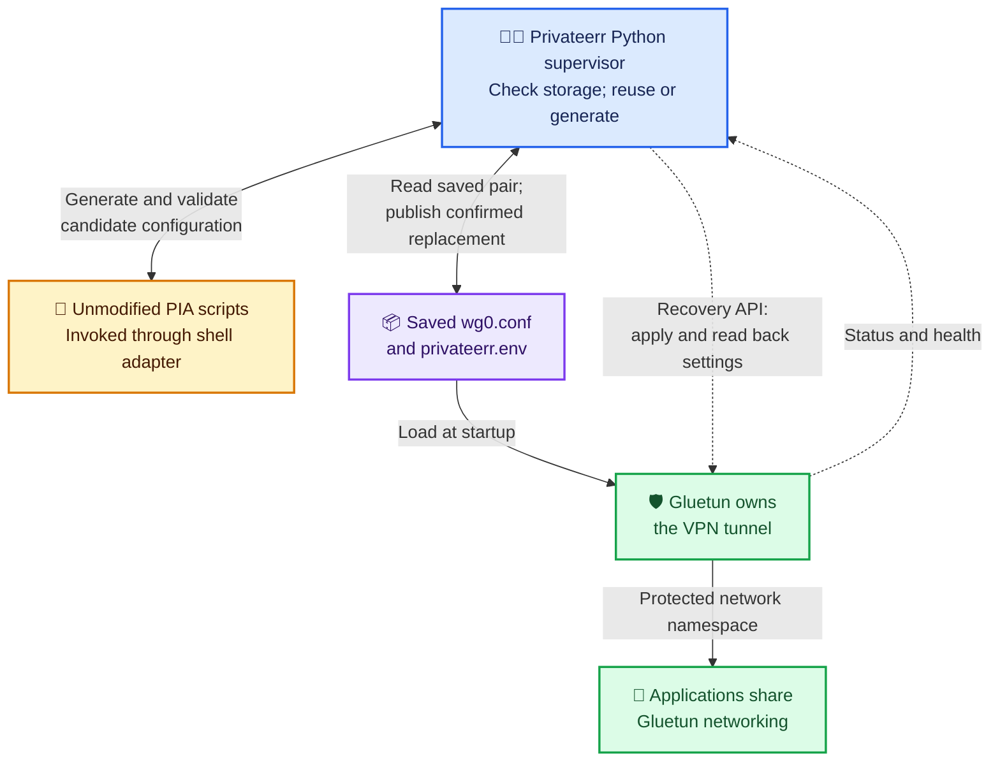

<!-- markdownlint-disable-next-line MD033 MD041 -->
<hr />

<!-- markdownlint-disable MD033 -->
<p align="center">
  <em>🦜 Parrot says: Found this useful? Drop a ⭐ an' help another crew find the map.</em>
</p>

<p align="center">
  <a href="https://github.com/scottgigawatt/privateerr/stargazers"></a>
  <a href="https://github.com/scottgigawatt/privateerr/forks"></a>
  <a href="https://github.com/scottgigawatt/privateerr/watchers"></a>
</p>

<p align="center">
  
  
  <a href="./LICENSE"></a>
</p>

<p align="center">
  <a href="https://github.com/scottgigawatt/privateerr/releases/latest"></a>
  
  <a href="https://www.bestpractices.dev/projects/13442"></a>
</p>

<p align="center">
  <a href="https://github.com/scottgigawatt/privateerr/actions/workflows/build-and-push.yml"></a>
  <a href="https://hub.docker.com/r/scottgigawatt/privateerr"></a>
  <a href="https://github.com/scottgigawatt/privateerr/pkgs/container/privateerr"></a>
  <a href="https://github.com/scottgigawatt/privateerr/actions/workflows/build-and-push.yml"></a>
</p>

<p align="center">─── ⛧ ───</p>

<p align="center">
  <em>💀 Questions or cursed code? Step forward… <strong>enter 🔥HADES🔥</strong>.</em>
</p>

<p align="center">
  <a href="https://discord.gg/BpEGzWwGYf"></a>
</p>
<!-- markdownlint-enable MD033 -->

<!-- markdownlint-disable-next-line MD033 -->
<hr />

# Privateerr 🏴‍☠️

Privateerr is a containerized configuration tool for [Private Internet Access (PIA)](https://www.privateinternetaccess.com/). It packages PIA's official, unmodified [manual-connection scripts](https://github.com/pia-foss/manual-connections) in a small Alpine container and uses them to generate a WireGuard configuration file plus PIA server metadata for automation.

Use Privateerr when you want `wg0.conf` for Gluetun, WireGuard, or another compatible VPN client—especially when a Docker Compose deployment needs to generate that configuration repeatably.

> [!IMPORTANT]
> Privateerr is not a virtual private network (VPN) client. It does not create or maintain a tunnel. It generates `wg0.conf` for a VPN client such as Gluetun or WireGuard. Its optional supervisor refreshes Gluetun's connection settings; Gluetun still owns the tunnel.

The upstream PIA scripts remain visible as the `docker/pia-manual-connections` submodule. Privateerr adds repeatable container execution, safe defaults, health reporting, and a small metadata handoff without modifying those scripts.

## Generate a WireGuard configuration ⚡

For one-shot generation, you need an active PIA subscription, Docker, Bash, and an interactive terminal. Paste this single command from Bash or zsh. It prompts for credentials without putting them in shell history and hides password input. Docker administrators can inspect the container environment while it runs.

The command below pulls the published image and writes `wireguard/wg0.conf` and `wireguard/privateerr.env` under your current directory. Keep these files private. Docker creates `wireguard` if it does not exist. Existing directories must allow container UID 0 to traverse the path and write files with all Linux capabilities dropped. Preserve any files you need and stop other writers before running it; generation replaces saved files.

```bash
bash -c '
IFS= read -r -p "PIA username: " PIA_USER </dev/tty || exit 1
IFS= read -r -s -p "PIA password: " PIA_PASS </dev/tty || exit 1
printf "\n"

if [[ -z "$PIA_USER" || -z "$PIA_PASS" ]]; then
    printf "%s\n" "Username and password are required." >&2
    exit 1
fi

export PIA_USER PIA_PASS

docker run --rm --pull always \
  --cap-drop ALL \
  --security-opt no-new-privileges:true \
  --env PIA_USER \
  --env PIA_PASS \
  --env VPN_PROTOCOL=wireguard \
  --env PIA_CONNECT=false \
  --env DISABLE_IPV6=no \
  --env DIP_TOKEN=no \
  --env AUTOCONNECT=true \
  --env PIA_PF=true \
  --env PIA_DNS=true \
  --env PRIVATEERR_KEEPALIVE=false \
  --volume "$(pwd)/wireguard:/gluetun/wireguard" \
  ghcr.io/scottgigawatt/privateerr:latest
'
```

This one-shot container uses recovery-disabled defaults, leaves IPv6 settings unchanged, and exits after generation. Your VPN client owns the tunnel. The prompts leave your invoking shell's variables unchanged.

For the repository workflow, use Git, Make, and Docker with Compose and Buildx. Clone the repository with its PIA submodule and create the private environment file:

```sh
git clone --recurse-submodules https://github.com/scottgigawatt/privateerr.git
cd privateerr
cp example.env .env
```

The public PIA submodule needs no GitHub SSH key. If cloning reports a submodule error or building reports a missing `pia-manual-connections/LICENSE`, follow [Recover a missing PIA submodule](docs/SUPPORT.md#recover-a-missing-pia-submodule).

Set `PIA_USER` and `PIA_PASS` in `.env` and keep the file private. Keep `PIA_VPN_PROTOCOL=wireguard` and `PIA_CONNECT=false` for configuration generation. The example selects a port-forwarding-capable region with `PIA_PF=true`. The Make command builds the checked-out source, disables recovery and keepalive for the disposable run, and exits after generation. It replaces saved VPN files, so preserve any files you need and stop a supervisor using that directory before running it:

```sh
make run-privateerr
```

The repository workflow writes:

| 📦 Output | 📍 Path | 🎯 Used by |
| --- | --- | --- |
| 🛡️ WireGuard configuration | `config/gluetun/wireguard/wg0.conf` | Gluetun, WireGuard, or another compatible VPN client |
| 🧭 PIA server metadata | `config/gluetun/wireguard/privateerr.env` | Compose automation that needs the selected endpoint, region, or port-forwarding details |

> [!WARNING]
> Keep live `wg0.conf` and `privateerr.env` files private. They contain VPN connection material and deployment-specific metadata. Use [example restoration](docs/advanced-usage.md#restore-vpn-examples) only in a stopped, disposable test checkout.

If you do not have Make, complete the same checkout and `.env` setup above, then use Compose directly. It reads your credentials and paths from `.env`. The same overwrite and single-writer precautions apply. Generate from the published image with:

```sh
docker compose --env-file .env run --rm --no-deps --pull always \
  --env PRIVATEERR_AUTO_RECOVER=false \
  --env PRIVATEERR_KEEPALIVE=false \
  --env PIA_CONNECT=false \
  --env VPN_PROTOCOL=wireguard \
  privateerr
```

To build the checked-out source instead, keep the PIA submodule initialized and use:

```sh
docker compose --env-file .env run --rm --no-deps --build --pull never \
  --env PRIVATEERR_AUTO_RECOVER=false \
  --env PRIVATEERR_KEEPALIVE=false \
  --env PIA_CONNECT=false \
  --env VPN_PROTOCOL=wireguard \
  privateerr
```

## Start Privateerr with Gluetun 🐳

The supplied Compose file runs Privateerr, Gluetun, and qBittorrent together. qBittorrent shares Gluetun's VPN namespace and receives its forwarded port. This application example requires amd64 or arm64; Privateerr itself also supports arm/v7.

After completing the repository checkout and `.env` setup above:

1. Generate a recovery API key:

    ```sh
    openssl rand -hex 24
    ```

2. Set `PRIVATEERR_GLUETUN_API_KEY` in `.env` to that value. Review qBittorrent's user/group IDs, storage paths, and Web UI port in the same file.
3. Start only the application services from published images. Bare `make up` includes Buccaneerr's deliberate VPN fault injection, so override its full-stack defaults explicitly:

    ```sh
    make up COMPOSE_UP_OPTIONS='--detach --no-build --pull always privateerr gluetun qbittorrent'
    ```

To build the checked-out Privateerr source instead, keep the PIA submodule initialized and use:

```sh
make up COMPOSE_UP_OPTIONS='--detach --build privateerr gluetun qbittorrent'
```

Without Make, use the same `.env` file and pull the published images before starting the three services:

```sh
docker compose --env-file .env pull privateerr gluetun qbittorrent
docker compose --env-file .env up --detach --no-build privateerr gluetun qbittorrent
```

Or build the checked-out Privateerr source with:

```sh
docker compose --env-file .env up --detach --build privateerr gluetun qbittorrent
```

Use `make ps` to inspect service status and `make logs` to read output. Without Make, use `docker compose --env-file .env ps` and `docker compose --env-file .env logs`. The qBittorrent Web UI uses the configured host port, `8080` by default; follow the [application access instructions](docs/automatic-recovery.md#try-the-qbittorrent-example) to obtain and change its initial password.

The example enables automatic recovery: Privateerr monitors Gluetun and refreshes stale PIA settings through its authenticated API. Configure the shared key before starting. See [automatic Gluetun recovery](docs/automatic-recovery.md) for timing, diagnostics, and custom deployments.

Buccaneerr is a separate test-only service that deliberately interrupts the VPN to verify recovery. Bare `docker compose up` or `make up` starts it too; use the explicit options and three-service commands above for normal startup. See [Buccaneerr's testing guide](test/README.md) when you intend to run live validation.

## Select a PIA region 🧭

Automatic selection is enabled by default. To pin a region, set `PIA_AUTOCONNECT=false` and `PIA_PREFERRED_REGION=ca` in `.env`. Replace `ca` with another PIA region ID when needed. See [region selection](docs/automatic-recovery.md#choose-a-region) for regeneration steps and recovery behavior.

## Understand the data flow 🧭

Privateerr's Python supervisor prepares a matching `wg0.conf` and `privateerr.env` pair before Gluetun starts. With recovery enabled, it reuses valid saved files, checks recovery storage access, and remains running to monitor Gluetun. Gluetun owns the tunnel and the network namespace shared by applications.



The dashed arrows are the optional recovery loop. Privateerr updates Gluetun through its API; changing a saved file alone does not refresh a running tunnel. It verifies applied settings and tunnel health before publishing recovered configuration, without restarting the containers. Privateerr's own healthcheck reports startup readiness, not current tunnel health or guaranteed recovery write access. See [diagnostics and filesystem checks](docs/automatic-recovery.md#read-diagnostics-and-check-storage) for warnings and region messages.

## Find commands and image channels ⚙️

Run `make` or `make help` for the command menu. The [maintenance reference](docs/advanced-usage.md#maintenance-reference) covers inspection, backups, cleanup, and generated files. [Buccaneerr's testing guide](test/README.md) explains offline checks and live PIA validation.

Privateerr and Buccaneerr support `linux/amd64`, `linux/arm64`, and `linux/arm/v7`; individual applications can support fewer architectures. Use `latest` for stable releases, `edge` to preview successful `main` builds, or an exact version to select a release. See [registry publishing and image channels](docs/advanced-usage.md#registry-publishing) for tags, registries, and supply-chain controls.

## Read more and get help 📚

- [Developer documentation](https://scottgigawatt.github.io/privateerr/): Supervisor architecture, contributor guides, and generated Python reference.
- [Advanced usage](docs/advanced-usage.md): Testing, builds, publishing, maintenance, and generated files.
- [Configuration directories](config/README.md): Runtime state and Gluetun handoff paths.
- [Host scripts](scripts/README.md): Backup, credential preflight, cleanup, and status helpers.
- [Buccaneerr testing](test/README.md): Offline checks and live end-to-end validation.
- [Support](docs/SUPPORT.md): Usage questions, bugs, documentation requests, and safe reporting routes.
- [Contributing](docs/CONTRIBUTING.md): Development setup and pull request expectations.
- [Security policy](docs/SECURITY.md): Supported versions and private vulnerability reporting.
- [Code of Conduct](docs/CODE_OF_CONDUCT.md): Community expectations and enforcement.

Privateerr is licensed under the [Apache License 2.0](LICENSE). The bundled PIA manual-connection scripts remain under PIA's [MIT license](https://github.com/pia-foss/manual-connections/blob/master/LICENSE).

Fair winds, private keys below deck, and no VPN-client identity crises. 🏴‍☠️
