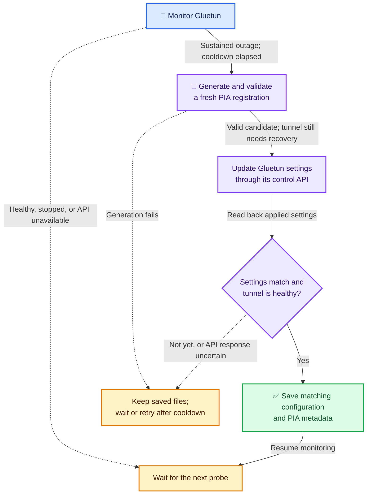

# Automatic Gluetun recovery 🧭

Privateerr can refresh a stale PIA WireGuard connection after a sustained tunnel outage. The supplied environment example enables it by default; configure its shared API key before starting. Privateerr remains a configuration generator; Gluetun still owns the tunnel, firewall, DNS, and port forwarding.

Recovery runs inside the existing Privateerr container and uses Gluetun's authenticated control API. It needs no additional service or Docker socket. The Gluetun container stays running, preserving the network namespace shared by applications such as qBittorrent. Existing connections may still disconnect while the tunnel changes.

## Configure recovery

Use the supplied Compose file and Gluetun entrypoint wrapper. The integration is tested against Gluetun **v3.41.3**; other versions must support the same authenticated control API routes and settings schema.

> [!IMPORTANT]
> Recovery makes Privateerr responsible for sustained-outage recovery and sets Gluetun's `HEALTH_RESTART_VPN=off`. Keep Privateerr outside Gluetun's VPN network namespace so it can reach PIA when the tunnel fails.

Follow these steps from the repository root:

1. Generate an API key:

    ```sh
    openssl rand -hex 24
    ```

2. Add the following settings to `.env`, replacing `YOUR-GENERATED-KEY` with that value:

    ```dotenv
    PRIVATEERR_AUTO_RECOVER=true
    PRIVATEERR_KEEPALIVE=true
    PRIVATEERR_GLUETUN_API_KEY=YOUR-GENERATED-KEY
    ```

3. Pull and start the application services so both VPN containers receive the configured environment. Changed settings recreate affected containers and can interrupt application traffic:

    ```sh
    make up
    ```

    This starts only Privateerr, Gluetun, and qBittorrent. Use `make up-build` to build Privateerr from the checkout instead; [the startup guide](https://github.com/scottgigawatt/privateerr#start-privateerr-with-gluetun-) also gives the raw Compose commands.

4. Read Privateerr's logs:

    ```sh
    docker compose logs privateerr
    ```

    Confirm that you see `Automatic recovery enabled`, followed by `Gluetun tunnel is healthy` after startup.

## Configure a custom deployment

The supplied wrapper disables Gluetun's health-triggered restarts when recovery is enabled because those restarts can race a settings update. WireGuard still reconnects naturally after brief network interruptions. Do not publish Gluetun's control or health ports to the host for this feature.

The supplied Compose stack gives both containers a shared Docker network. When recovery is enabled, the Gluetun wrapper changes the default health listener from `127.0.0.1:9999` to `0.0.0.0:9999` and creates a temporary API authentication file with only the required routes. When recovery is disabled, the listener, authentication, and Gluetun restart policy remain unchanged.

For a custom deployment, use the supplied wrapper or configure `HEALTH_RESTART_VPN=off`, the shared network, health listener, and API authentication yourself.

If an authentication file already exists at `/gluetun/auth/config.toml`, or `HTTP_CONTROL_SERVER_AUTH_CONFIG_FILEPATH` names a custom path, the wrapper preserves that file. Add a role with your shared key and these routes:

- `GET /v1/vpn/status`
- `GET /v1/vpn/settings`
- `PUT /v1/vpn/settings`
- `GET /v1/portforward`

Follow [Gluetun's authentication documentation](https://github.com/qdm12/gluetun-wiki/blob/main/setup/advanced/control-server.md#authentication). Settings responses contain secrets; do not paste them into support discussions.

## Restart a healthy stack

With `PRIVATEERR_AUTO_RECOVER=true`, restarting or recreating the stack reuses the valid saved `wg0.conf` and `privateerr.env`. It does not rerun PIA's lowest-latency selection or switch servers while Gluetun remains healthy. Privateerr monitors the reused connection and refreshes it after a sustained outage.

To request a fresh registration or rerun automatic server selection, follow the [regeneration steps](#choose-a-region). With recovery disabled, Privateerr generates fresh files each time it starts.

## Choose a region

Automatic selection remains the default. To select the `ca` region, edit `.env`:

```dotenv
PIA_AUTOCONNECT=false
PIA_PREFERRED_REGION=ca
```

`PIA_PREFERRED_REGION` defaults to `ca` in `example.env`. Choose another PIA region ID to use that region instead. `PIA_AUTOCONNECT=true` takes precedence and ignores the preferred region.

Recovery-enabled startup reuses a valid saved pair, so changing the environment and recreating containers alone does not immediately replace a healthy connection. To apply a region or forwarding-selection change, stop the selected Compose project, generate a fresh pair, and start it from the checked-out source. This interrupts application traffic, removes the project containers and network, and replaces the saved VPN files; preserve any configuration you need first. Volumes and images are retained. Run each command only after the previous command succeeds:

```sh
make down
make run-privateerr
make up-build
```

The one-shot command disables recovery and keepalive only for that run. Stopping the supervisor prevents two writers from replacing the same files. `make up-build` recreates only the three application services and keeps the locally built Privateerr image. A plain restart does not reload environment changes.

Recovery tries another advertised endpoint in the selected region. A pinned region never falls back to another region. Automatic selection prefers other endpoints in the current region, then other eligible regions in the server catalog; recovery does not rerun a full latency benchmark. With `PIA_PF=true`, only regions advertising port forwarding are eligible. If no unused endpoint remains, Privateerr attempts fresh registration against the current permitted endpoint. Dedicated IPs retain their dedicated endpoint through upstream setup.

## How the supervisor runs

A small Python supervisor runs in the existing Privateerr container. It uses the standard library to manage recovery state, validate connection settings, and call Gluetun. A shell adapter invokes the unmodified upstream PIA scripts; Gluetun's startup wrapper remains shell. There is no additional container, web server, or production Docker socket.

The supervisor measures elapsed time independently of the system date and time, so host clock corrections do not change outage thresholds or retry delays. It also bounds HTTP requests and PIA generation. See [recovery timing and resource limits](development/privateerr/architecture.md#bound-work-and-protect-credentials) for the implementation details. Container shutdown interrupts waits and stops the active generation process group. Python test and lint tools stay in Buccaneerr.

The example uses `restart: unless-stopped` for Privateerr, Gluetun, and qBittorrent so Docker restarts exited services and brings them back after a host reboot unless you explicitly stopped them. This container policy is separate from tunnel recovery and does not restart a container merely because its healthcheck fails. Buccaneerr keeps `restart: "no"` so its test result remains final.

For one-shot generation, `make run-privateerr` disables recovery and keepalive for a disposable `docker compose run --rm` container; it exits after generation without changing `.env`. Stop the running supervisor before generating into the same configuration directory. Custom one-shot deployments should set `PRIVATEERR_AUTO_RECOVER=false`, `PRIVATEERR_KEEPALIVE=false`, and `restart: "no"`.

## Understand the recovery sequence

Privateerr validates the saved configuration or generates a new pair before reporting ready. Gluetun can therefore retain `depends_on: service_healthy`; Privateerr's Docker healthcheck does not depend on a working tunnel.

With recovery enabled, the monitor follows this sequence after the startup grace period. Blue marks monitoring, purple marks the settings handoff, green marks a verified save, and amber marks waiting or retrying. The arrow labels explain each transition.



Waiting returns to the next monitoring cycle. Before retrying an uncertain update, Privateerr checks what Gluetun actually applied; it does not immediately generate another candidate.

After the startup grace period, Privateerr checks Gluetun's control API and tunnel health. A sustained outage triggers one fresh PIA registration. Generation uses staging files and a deadline, leaving saved configuration untouched on failure. The upstream PIA scripts remain unmodified.

Privateerr submits the new WireGuard keys, address, endpoint, and PIA server name together through `PUT /v1/vpn/settings`. Gluetun restarts its internal tunnel. Privateerr reads back the applied settings and waits for tunnel health before saving the new configuration and metadata. An ambiguous API timeout is reconciled before another candidate is generated. Pending candidates and an interrupted publication can be recovered after Privateerr restarts.

Privateerr reports port-forwarding status separately. Gluetun continues obtaining and renewing the forwarded port; a forwarding-only failure does not cause Privateerr to rotate otherwise healthy tunnels. Existing application port-update hooks remain Gluetun's responsibility.

## Read diagnostics and check storage

Use Dockge's Privateerr service logs, Synology Container Manager's container log view, or the repository command below. Diagnostics appear in container output and, when available, the configured `PRIVATEERR_LOG_PATH` file.

```sh
docker compose logs --tail 100 privateerr
```

Supervisor messages include severity and the failed operation. Filesystem errors report the affected container path, error category, process UID/GID, and available path ownership and mode. They distinguish permission denial, a read-only filesystem, missing paths, disk exhaustion, and quota limits. The logged path identifies the location inside the container; find its corresponding host path in your Compose volume mapping. Permission denial alone does not prove an ACL problem.

At startup, Privateerr tests creating a temporary directory, writing and replacing disposable files, and removing them beside the saved pair. It does not modify existing configuration, ownership, modes, or ACLs. A successful check does not guarantee future writes or access to every pre-existing recovery file; actual operations retain their own diagnostics. Cleanup failure or abrupt termination can leave a `.privateerr-check.*` probe directory behind.

If a valid saved pair is reusable but the check fails, Privateerr warns that recovery storage is unavailable and still reports startup readiness so Gluetun can start. If new configuration is required, the storage failure stops startup with a specific error. This fallback applies to the disposable storage probe; failures preparing output directories, opening the persistent log, resuming an interrupted save, or clearing/writing the readiness marker can still stop startup. Docker's Privateerr healthcheck continues to mean valid startup files exist; it does not certify current VPN health or future recovery capability.

For a permission error, give the container's UID 0 write and traverse access to the intended host output directory, accounting for any runtime UID remapping. The `:rw` mount option does not override host permissions. Keep `cap_drop: ALL` and `no-new-privileges`; do not broadly apply `chmod 777` or strip ACLs. For a read-only mount or disk/quota failure, correct that specific condition. New registration attempts use the recovery cooldown and report their next delay. A retained candidate is checked on subsequent monitoring cycles before another registration is considered; its readback or publication can therefore be retried without waiting for a new-registration cooldown. Restarting only Privateerr resets process timers but does not repair storage permissions or force a new registration.

API failures report a safe category and HTTP status when available. A `401` or `403` points to API authentication or authorization; a timeout or connection failure needs connectivity investigation. An unconfirmed settings update retains its candidate for readback. If local publication fails after Gluetun accepted the update, the log identifies persistence/reconciliation failure rather than claiming that the API update never happened. The running tunnel can already use the candidate while the saved pair is older or only partly replaced. Fix the reported storage condition and preserve `.privateerr-pending` and `.privateerr-commit`; the supervisor checks settings and health before retrying publication. Do not delete retained state or regenerate concurrently to clear the warning. See [publication state and file lifetimes](development/privateerr/architecture.md#confirm-updates-before-saving).

### Understand VPN region messages

Privateerr logs the provider-advertised region from saved metadata when reusing configuration, the candidate region after generation, and the saved region after confirmed recovery. Missing or malformed optional region labels appear as `unknown` and do not invalidate an otherwise usable pair. A reused or generated configuration is not proof of a healthy connection.

Region labels describe the selected VPN destination, not the operator's location, measured latency, or proof of the physical server location. Automatic recovery prefers eligible endpoints without rerunning the full startup latency benchmark. These summaries omit keys, tokens, credentials, endpoint addresses, and full API responses. Region choice and diagnostic paths are still operational information; review logs before sharing them publicly.

## Configure timing

Set these values in `.env` using `example.env` as the starting point. Compose deliberately supplies no fallback values. Custom deployments use the image defaults, with recovery disabled unless explicitly enabled.

| Variable | Default | Purpose |
| --- | --- | --- |
| `PRIVATEERR_AUTO_RECOVER` | `true` in the environment example | Enable the recovery monitor |
| `PRIVATEERR_GLUETUN_URL` | `http://gluetun:8000` | Authenticated control API |
| `PRIVATEERR_GLUETUN_HEALTH_URL` | `http://gluetun:9999` | Tunnel health endpoint |
| `PRIVATEERR_RECOVERY_INTERVAL_SECONDS` | `30` | Seconds between probes |
| `PRIVATEERR_RECOVERY_FAILURE_SECONDS` | `120` | Startup grace and continuous failure threshold, in seconds |
| `PRIVATEERR_RECOVERY_COOLDOWN_SECONDS` | `300` | Initial seconds between attempts; doubles on failures up to one hour |
| `PRIVATEERR_GENERATION_TIMEOUT_SECONDS` | `180` | Maximum seconds for each upstream generation |

At startup, Privateerr waits through the grace period before monitoring. Recovery then requires a continuous failure lasting the configured threshold, measured from an unhealthy probe. Gluetun's own periodic probes and retries add detection time, so a blocked endpoint can take several minutes to trigger recovery. Healthy probes reset the failure timer. A manually stopped VPN pauses recovery. Failed API authentication or an unreachable control server does not cause repeated configuration generation.

## Compatibility and limits

The Compose example enables recovery; custom image-only deployments must explicitly set `PRIVATEERR_AUTO_RECOVER=true`. Recovery requires keepalive mode, a private shared API key, and `PIA_CONNECT=false`. An explicitly selected region requires `PIA_AUTOCONNECT=false`.

Recovery requires the configuration and metadata to share a directory mount and one Privateerr instance to own those files. `wg0.conf` and `privateerr.env` are regular files. Privateerr keeps copies of both files in `.privateerr-commit` until both replacements finish, allowing startup to complete an interrupted save. It stores a candidate awaiting API and health confirmation in `.privateerr-pending`. Both directories sit beside the generated files. Do not delete those directories during recovery. A normal one-shot regeneration still replaces saved files; avoid running it concurrently with the monitor.

Privateerr cannot start a stopped Gluetun container or repair a hung Docker daemon. An unavailable PIA service, invalid account credentials, or a fully unavailable pinned region can also prevent recovery. Logs identify those failures while the saved configuration remains available. Repeated failures use a cooldown rather than a container restart loop.

## Run without privileged mode

The example runs Privateerr with all Linux capabilities dropped and `no-new-privileges` enabled. UID 0 remains necessary because the unmodified upstream PIA scripts explicitly require it. Gluetun owns the VPN interface and retains its separate `NET_ADMIN` capability; Privateerr only generates configuration and calls the control API.

`PRIVATEERR_IPV6_DISABLED=1` makes Docker disable IPv6 in Privateerr's network namespace before startup. It does not change host or Gluetun settings. Keep the default alongside `PIA_DISABLE_IPV6=yes`; the wrapper skips redundant upstream writes when Docker has already applied those settings. Keep configuration directories writable by the container's UID 0.

The supplied VPN services carry labels disabling unattended Watchtower updates. Intentional image replacement can still interrupt that container briefly. Container options control privileges, capabilities, and sysctls; pulling an image does not change those options.

## Disable recovery

Set `PRIVATEERR_AUTO_RECOVER=false` in `.env`. Applying the changed environment recreates affected containers, interrupts traffic, and causes Privateerr to replace the saved configuration pair; preserve any configuration you need before proceeding:

```sh
make up
```

Gluetun resumes its configured health-restart policy. Privateerr returns to ordinary startup behavior and generates a fresh configuration pair. The command leaves Buccaneerr's deliberate fault-injection test out of the application startup.

## Understand container and application limits

Docker health status alone does not restart a container. [`depends_on.restart: true`](https://docs.docker.com/reference/compose-file/services/#depends_on) follows explicit Compose operations, not every Docker runtime restart. Recreating Gluetun outside Compose can leave dependent applications attached to the replaced network namespace; recreate them together. Privateerr has no Docker socket or container-management authority.

The bounded forwarding hook reports failed application updates. If qBittorrent stays unavailable longer than its configured wait, restore the application and reapply the current port with the hook or restart forwarding. Privateerr does not provide an application watchdog.

## Try the qBittorrent example

Privateerr generates configuration, Gluetun creates the VPN namespace, and qBittorrent runs inside it. The LinuxServer qBittorrent image supports amd64 and arm64; Privateerr's arm/v7 support does not extend to this application. Configure these values in `.env`:

```dotenv
QBITTORRENT_PORT_SYNC=true
QBITTORRENT_WEBUI_PORT=8080
QBITTORRENT_API_WAIT_SECONDS=300
```

Set `QBITTORRENT_PUID`, `QBITTORRENT_PGID`, and the configuration/download paths from `example.env` to match the host. Complete the recovery setup above, then pull and start the three application services:

```sh
make up
```

Use `make up-build` when you want to build Privateerr from the checkout instead.

The Web UI is published on the Docker host at the port selected by `QBITTORRENT_WEBUI_PORT` (8080 by default). Changing that value also updates the internal listener, healthcheck, forwarding hook API URL, and Buccaneerr checks. LinuxServer [recommends matching both sides of the port mapping and `WEBUI_PORT`](https://docs.linuxserver.io/images/docker-qbittorrent/#webui) because mismatched ports can cause CSRF and login problems. Keep those ports synchronized rather than fixing the container side at `8080`. The Gluetun API and health listener remain unpublished. Set `QBITTORRENT_WEBUI_PORT` in `.env` if port 8080 is already in use.

The seed configuration allows unauthenticated API access only from loopback, where Gluetun's hook runs. Remote Web UI sessions still require authentication; obtain the initial password from qBittorrent's local container logs and change it in the Web UI. Do not share those logs. Other containers deliberately sharing Gluetun's namespace also share that loopback trust boundary.

The hook binds qBittorrent to the VPN interface and assigned port, with random ports and UPnP disabled. On lease removal it binds to loopback. An existing application configuration is not overwritten; ensure its localhost API access permits the hook. VPN peer ports do not need host publication.

### Test the example

Buccaneerr is a separate validator in the `test` profile. Normal startup does not start it. With `BUCCANEERR_TEST_RECOVERY=true`, it deliberately blocks the active VPN endpoint, then verifies a new registration, healthy tunnel, matching saved files, and qBittorrent settings. Its `NET_ADMIN` capability applies only inside the shared test namespace; it needs no Docker socket and removes its firewall rule on completion or failure. The default recovery deadline is 600 seconds, including Gluetun's health-detection delay. Set `BUCCANEERR_TEST_RECOVERY=false` for a connectivity-only run.

Use the following only in a disposable test project with real PIA credentials. It enables the `test` profile, starts all four services, replaces generated VPN files, and deliberately interrupts the VPN; preserve any configuration you need first:

```sh
make test-e2e
```

See [Buccaneerr testing](https://github.com/scottgigawatt/privateerr/blob/main/test/README.md) for verification, safe cleanup and example restoration, plus the separate credential-free API and live recovery suites. Those isolated suites run their tools inside Buccaneerr, create only labeled temporary Gluetun/qBittorrent containers, and do not start the root example or download torrents. The live recovery suite also checks incoming TCP through the PIA lease; it does not claim UDP reachability or torrent throughput. `make build` and `make build-buccaneerr` build only their respective images.
