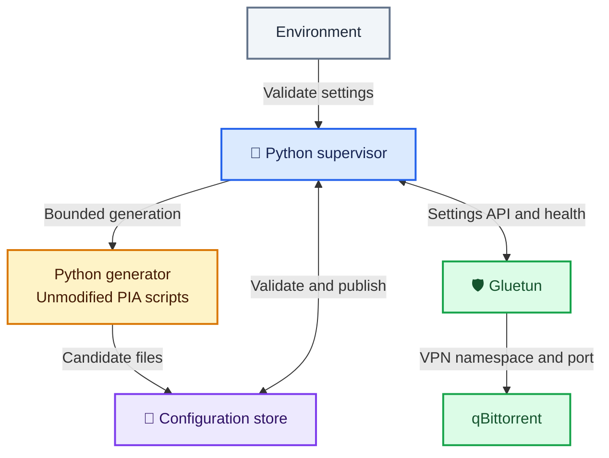

# Supervisor architecture ⚙️

Privateerr separates configuration generation from tunnel ownership. Its single-threaded supervisor calls the existing PIA scripts, validates their output, and applies a small connection update through Gluetun's authenticated API. Gluetun keeps its network namespace throughout recovery, so qBittorrent remains attached to the same container network.

## Follow the data

Blue marks the supervisor, amber marks upstream generation, purple marks saved and staged files, and green marks the VPN and application. The two-way API arrow covers authenticated settings updates, settings readback, and health probes. The storage arrow covers reading validated candidates and publishing them after confirmation.

The supervisor reads environment settings once at startup. Each upstream PIA invocation runs in a separate process group. Generated VPN files go to a private staging directory; combined stdout and stderr are piped to Python for redacted logging. Python owns generation orchestration, IPv6 adaptation, catalog enrichment, and metadata serialization. One monotonic work deadline covers upstream execution and metadata lookup; process cleanup can add up to five seconds of grace before remaining group members are killed. Chunked output reads remain bounded even when a child stays silent, omits a newline, or writes continuously. Only validated connection fields are sent to Gluetun; its unrelated DNS, firewall, and provider settings remain intact.

## Separate readiness from tunnel health

Long-running startup first installs the two scripts packaged under `${PRIVATEERR_BIN_HOME}/gluetun/` into `scripts/` beside the WireGuard directory. Both files are staged with executable permissions before each is atomically replaced. Temporary staging is removed on success or failure; installation errors prevent readiness. The installer leaves other scripts, authentication, and VPN state untouched. These are generated files, not operator-managed configuration. In unreleased source, `Config.one_shot` skips this installation; [one-shot generation](https://github.com/scottgigawatt/privateerr#generate-a-wireguard-configuration-) publishes a matching VPN pair and exits.

Startup then completes any interrupted VPN file publication. With recovery enabled, an existing valid configuration pair can be reused; otherwise Privateerr generates and saves one. A disposable create/write/replace/delete probe checks recovery storage. When a valid pair is reused, probe failure warns without preventing Gluetun startup; when generation is required, it fails with a specific diagnostic. Existing files and permissions are not changed by the probe. The startup marker, `/healthcheck/privateerr.ready` by default, then allows Gluetun to start. `PRIVATEERR_HEALTHCHECK_MARKER` can change its path. It confirms valid VPN files; long-running startup also guarantees installed scripts, even with recovery disabled. It does not prove tunnel health, avoiding a circular startup dependency.

Recovery begins after the startup grace period. Every probe checks control API access, intentional stop state, pending updates, and tunnel health before considering another registration. A sustained failure must exceed the configured threshold and retry cooldown. Healthy probes reset the failure timer and retry delay.

## Confirm updates before saving

A settings update can succeed even if its HTTP response is lost. Privateerr therefore retains a complete candidate before submitting it, then reads back Gluetun's active settings. Matching connection fields and a healthy tunnel are both required before replacing saved configuration.

All paths below except the startup marker are relative to the shared configuration directory, `/gluetun/wireguard` in the example deployment.

| Directory or file | Meaning | Lifetime |
| :--- | :--- | :--- |
| `.privateerr-check.*` | Disposable startup filesystem probe | Normally removed on completion or failure; cleanup failure or abrupt termination can leave a probe behind |
| `.privateerr-stage.*` | Temporary output from one PIA generation | Removed when generation completes, fails, or is interrupted |
| `.privateerr-pending/` | Candidate awaiting API and health confirmation | Retained across uncertain updates and process restarts; removed after acceptance or rejection |
| `.privateerr-commit/` | Complete source copies for interrupted publication | Removed after both saved files have been replaced |
| `ready` inside `.privateerr-pending/` or `.privateerr-commit/` | Both copied files have passed validation | Written last; removed with its containing directory |
| `settings.json` inside those same directories | Validated connection fields recorded alongside the copied files | Retained and removed with its containing directory; contains private key material |
| `wg0.conf.new` or `privateerr.env.new` | Temporary replacement of one published file | Renamed over its destination during publication; an interrupted replacement is rewritten on resume |
| `wg0.conf` and `privateerr.env` | Matching published connection and PIA metadata | Retained for Gluetun startup until a verified replacement or explicit regeneration |
| `/healthcheck/privateerr.ready` | A usable saved pair exists; long-running startup also confirms script installation | Cleared at Privateerr startup and recreated after validation; unrelated to current tunnel health |

Each file replacement is atomic, but replacing the pair is not one filesystem transaction. The commit directory retains both source files so startup can finish an interrupted save. Its `ready` file, and the equivalent file in the pending directory, identify complete validated copies. They are separate from the startup healthcheck marker. A directory without its `ready` file is an incomplete copy and is discarded instead of applied.

## Bound work and protect credentials

HTTP requests have a total deadline and a response-size limit. Redirects are rejected, inherited HTTP proxies are ignored, and only control requests receive the API key. External JSON remains untrusted until its structure and fields are validated. Python parses generated metadata as data. Gluetun's shell wrapper sources the same file, so the generator validates scalar identities and escapes shell expansion characters in display labels before writing it.

The supervisor measures outage and retry intervals with a **monotonic clock**: an elapsed-time counter that only moves forward and is unaffected by changes to the system date or time. Correcting the host clock therefore cannot shorten a recovery cooldown or make an outage appear older. These timers start afresh when the supervisor process restarts; retained candidate files are reconciled separately. PIA generation has a deadline; shutdown interrupts waiting and stops the generation process group. New files use a restrictive umask. Supervisor-authored diagnostic summaries omit credentials, keys, and response bodies; complete Docker or persistent logs can also contain upstream and application output. Inspect and redact the full excerpt before sharing it, including operational paths and region preferences.

## Read consistent generation logs

Console and persistent logs use UTC timestamps, severity, and a source label. `[privateerr]` identifies application messages; `[PIA/run_setup.sh]` identifies output from the unmodified setup invocation, including its children. Targeted recovery invokes and labels `get_token.sh` and `connect_to_wireguard_with_token.sh` separately. Invocation labels do not claim to identify every nested child script.

Python replaces known credential values and recognized credential fields, removes ANSI CSI sequences and C0 controls except tabs, and then forwards upstream output to the logging handlers. This best-effort filter follows upstream output conventions; it cannot guarantee removal of unrecognized secret formats. Empty lines are omitted; oversized lines are discarded as a whole rather than exposing partially redacted fragments. Ordinary upstream output uses `INFO`; a nonzero process exit produces a separate application error with the script name and exit status. Both output destinations use the same formatter.

The `.privateerr-stage.*` directory isolates each candidate from the saved pair. Its random suffix prevents attempt collisions. Published-path success messages are emitted only after a verified save; one-shot generation ends with `Generation complete.` rather than waiting for a Gluetun container that it did not start.

The date compatibility shim translates PIA's GNU-style date arguments and delegates execution to BusyBox date. It remains necessary for PIA's `--date='1 day'` call; it does not install GNU coreutils. The healthcheck remains the existing readiness-marker shell check.

## Diagnose failures without disclosing secrets

`diagnostics.py` wraps filesystem operations with a known operation and path. It reports error categories and numeric ownership instead of raw exception messages. Startup preparation, staging, configuration reads, publication, and persistent-log access retain their own context. Pending-update persistence failures preserve reconciliation semantics rather than being misreported as API failures. HTTP errors retain safe categories and status codes without recording headers, bodies, or credentials.

The supervisor adds severity and next-attempt delay to recovery failure messages. Repeated identical status failures are suppressed. Optional region names and IDs are read from metadata, bounded, and filtered before logging; unknown or malformed labels do not prevent reuse or publication. Candidate logs precede API application and cannot imply a healthy tunnel. Confirmed region logs follow settings readback, health verification, and successful publication.

Privateerr runs as UID 0 with a restrictive umask. Permission diagnosis does not change ownership or ACLs. A passed probe is only an early check; actual operations can still fail later.

## Respect recovery limits

Pinned deployments stay within the selected region. Automatic selection prefers untried endpoints in the saved region, then other eligible regions. Port-forwarding deployments require eligible regions; dedicated-IP selection stays with upstream PIA setup.

An unavailable control API, intentionally stopped VPN, or forwarding-only failure does not trigger blind regeneration. Privateerr does not restart containers or repair Docker. Gluetun remains responsible for the port lease and qBittorrent update hooks. See the [recovery sequence and limitations](../../automatic-recovery.md#understand-the-recovery-sequence) for operator-facing behavior.
